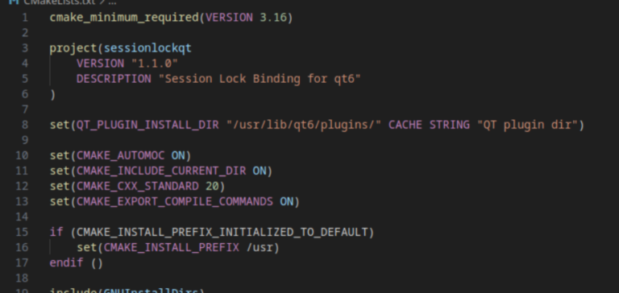
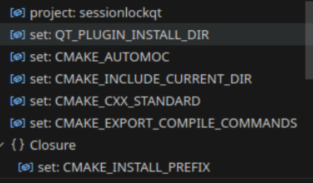
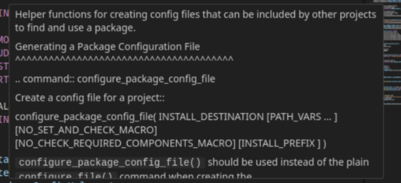

# neocmakelsp vscode plugin

This plugin is for [neocmakelsp](https://github.com/Decodetalkers/neocmakelsp)
on vscode, it providing:

- code completion
- compile errors and warnings
- go-to-definition and cross references
- hover information
- code formatting
- highlight
- AST tree

## Settings

neocmakelsp can use tcp way to start, and it can be set to use local target, not
download asserts from github, you can set them like

```json
{
  "neocmakelsp": {
    "tcp": true,
    "localtarget": true,
    "path": "${env:HOME}/.cargo/bin/neocmakelsp"
  }
}
```

NOTE: this feature only enable on unix system which has `nc` command.

## Debugging

The CMake debugger is contributed as `neocmakelsp-cmake`, separate from the `cmake`
debugger type used by Microsoft's CMake Tools extension, so both extensions can be
enabled together.

Set `neocmakelsp.debug` to `true` to show the neocmakelsp debug commands:

```json
{
  "neocmakelsp.debug": true
}
```

You can also use `"type": "neocmakelsp-cmake"` in `launch.json`. If an existing
configuration uses `"type": "cmake"` for this debugger, change it to
`"type": "neocmakelsp-cmake"`; the `cmake` type belongs to Microsoft's CMake Tools
extension.

## Feature show

### highlight



### Ast tree



### Hover


